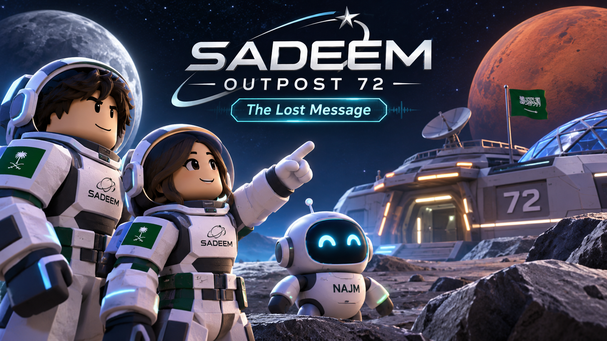

# 🚀 SADEEM | OUTPOST 72
### The Lost Message — Explore. Decide. Survive.

**NASA Space Apps Challenge 2026**  
**Challenge: Build a Junior Astronaut Mission Trainer**  
**Team SADEEM 🇸🇦 | Saudi Arabia**

  

---

## 🌌 The Mission

**Year 2045. A mysterious signal. A forgotten space outpost.**

A Saudi astronaut crew arrives at Outpost 72 to investigate a mysterious transmission. But the mission quickly becomes a race against time.

With the help of **NAJM**, their robotic companion, players must explore the outpost, restore essential systems, uncover three hidden messages, and solve the final mystery.

**Every decision matters. Every resource counts.**

## 🎮 Gameplay Preview

*One mission. Three messages. A mystery waiting to be solved.*

> 🎥 Watch the crew explore Outpost 72, interact with NAJM, and discover the secrets hidden inside the station.

## 🪐 Game Features

- **Interactive Space Exploration** — Discover a futuristic outpost inspired by real space science.
- **Mission-Based Gameplay** — Complete objectives and overcome challenges.
- **Resource Management** — Balance oxygen, energy, and other survival resources.
- **The Three-Message Mystery** — Collect clues and uncover the final message.
- **NAJM, Your Robot Companion** — Navigate the mission with your robotic guide.
- **Multiplayer Adventure** — Designed for cooperative play with up to four players.
- **Bilingual Experience** — Arabic and English support.

## 🌍 Why Roblox?

Why teach space science only through textbooks when students can experience it through a world they already love?

SADEEM transforms complex space engineering concepts into an interactive adventure where players learn by exploring, experimenting, and making decisions.

**Our goal:** Make space education accessible, exciting, and unforgettable.

## 🛰️ Powered by NASA Science

SADEEM draws inspiration from NASA's publicly available educational and scientific resources, including:

- Moon and Mars exploration
- Life-support systems
- Energy and resource management
- Space habitats and environmental challenges
- Mission planning and astronaut survival

📚 **[Explore Our NASA Data and Sources](NASA_DATA_AND_SOURCES.md)**

*SADEEM is an independent educational project and is not endorsed by NASA. The story is fictional, and gameplay resource values are designed for educational game balance.*

## 👩‍🚀 Meet Team SADEEM

| Team Member | Role |
|---|---|
| **Yara Hamami** | Game Developer & Team Lead |
| **Hams Alhamandi** | Game Developer & QA Tester |
| **Shatha Mukhrish** | Level Designer & Storyteller |
| **Relam Alhazmi** | NASA Data & Research |
| **Lamees Hummadi** | UI/UX Designer & Video Editor |

## 🛠️ Built With

- **Roblox Studio** — Game development
- **Luau** — Game scripting
- **NASA Open Resources** — Scientific research and educational inspiration
- **GitHub** — Project documentation and version control

## 📂 Project Files

| File | Description |
|---|---|
| `SADEEM_GAME.rbxl` | Roblox Studio game project |
| `README.md` | Project overview |
| `PRD.md` | Product requirements |
| `NASA_DATA_AND_SOURCES.md` | NASA data documentation |
| `SADEEM_Cover.png` | Official game cover |

## 🚀 Play the Game

**[🎮 PLAY SADEEM ON ROBLOX](https://www.roblox.com/share?code=3885c530b095d745808a4fd2af8d81a3&type=ExperienceDetails&stamp=1794626377726)**

---

### ✨ Explore. Decide. Survive.

*Built with curiosity, creativity, and a passion for space.*

**Made by Team SADEEM 🇸🇦 — NASA Space Apps Challenge 2026**
